<p align="center">
  
</p>

<h1 align="center">MLX Studio</h1>

<p align="center">
  Run, chat with and serve AI models locally on your Mac with Apple Silicon.<br>
  <a href="https://studio.mlx.app">studio.mlx.app</a> &bull;
  <a href="https://github.com/MLXapp/studio/releases">Releases</a> &bull;
  Built on <a href="https://github.com/jjang-ai/vmlx">vMLX</a> by JANGQ AI
</p>

---

MLX Studio is a desktop app for macOS (Apple Silicon) that runs large language,
vision, image and audio models on your own Mac with Apple's
[MLX](https://github.com/ml-explore/mlx) framework. Models run locally; prompts and
outputs stay on the Mac unless you point the app at a remote endpoint yourself.

It is a modified version of [vMLX](https://github.com/jjang-ai/vmlx) by JANGQ AI
(Apache License 2.0). The inference engine is vMLX's Python engine (`vmlx_engine`,
published on PyPI as `vmlx`); MLX Studio changes the desktop app around it. See
[NOTICE](NOTICE) and [docs/MLX-STUDIO.md](docs/MLX-STUDIO.md) for what changed.

## What it does

Summarised from the vMLX engine and app it is built on:

- **Chat** with local models: chat history, reasoning ("thinking") display, tool
  calling with built-in tools and MCP servers, image/audio/video attachments for
  models that support them.
- **Servers & API**: start, stop and configure model sessions. Each session serves an
  OpenAI-compatible API (chat completions, responses, embeddings), the Anthropic
  Messages format and Ollama-style endpoints, plus a gateway that routes to every
  loaded model; a live endpoint reference with copy-paste snippets.
- **Models**: search and download from Hugging Face, inspect and diagnose local
  models, convert to MLX (including vMLX's JANG quantization).
- **Image** generation and editing with Flux-family and Qwen Image models via
  [mflux](https://github.com/filipstrand/mflux).
- **Engine features** from vMLX: continuous batching, prefix and paged KV caches,
  KV cache quantization, SSD-backed cache, speculative decoding, hybrid SSM/Mamba
  support, Kokoro TTS and Whisper STT via mlx-audio.
- **Network** (new in MLX Studio): live figures from the
  [MLX Network](https://mlx.app), whether
  [MLX Node](https://mlx.app/download) is installed and running (and installing
  it), and your wallet's live mining if you enter its name.

Model support, speed and memory use depend on the model, its quantization and your
Mac. The engine's full options are documented in the upstream
[vMLX README](https://github.com/jjang-ai/vmlx#readme).

### MLX Studio includes MLX Node

MLX Studio includes MLX Node. They are two separate apps. **MLX Studio** runs
models for you. **MLX Node** (bundle `app.mlx.mac`) is a menu bar app that lends
your Mac's idle time to MLX Network and earns MLX Tokens.

Release builds of MLX Studio carry the current signed and notarized MLX Node. On
first launch, if MLX Node isn't installed, MLX Studio asks once: "Also install MLX
Node?" Choosing **Install MLX Node** copies it to `/Applications/MLX Node.app`
(`~/Applications` if `/Applications` can't be written), checks its signature and
opens it. It never replaces an existing copy. After that MLX Node updates itself
and you can quit or remove it any time; removing MLX Studio leaves it in place. You
can also install or open it later from the Network page or Preferences, or download
it from [mlx.app/download](https://mlx.app/download).

MLX Studio itself only reads public network figures; it never mines. MLX Tokens
are a crypto asset; read the [risks](https://mlx.app/risks).

## Install

Download the DMG from [Releases](https://github.com/MLXapp/studio/releases) when one
is published (macOS 14.5 or newer, Apple Silicon) and drag MLX Studio to
Applications.

Not sure which models your Mac can hold? [mlx.app/mac](https://mlx.app/mac) lists
every open model that fits each Apple Silicon Mac and memory size, with the version
that fits and an estimated speed; [mlx.app/run](https://mlx.app/run) starts from the
model instead.

### Updates

MLX Studio updates itself. It checks `latest.json` in this repository at launch,
every 6 hours, and when you choose **MLX Studio → Check for Updates…**. When a new
version is out, a banner appears at the top of the window (and a notification, once
per version, if MLX Studio isn't in front). Click **Update**: it downloads the new
version with a progress bar, checks it (size, SHA-256, Developer ID signature from
our team, Apple notarization, newer version), then shows **Restart to update**.
MLX Studio quits, swaps in the new copy at the same place and opens again. If you
quit instead, the update is installed for the next launch. **Later** hides the
banner until the next version or the next launch.

If MLX Studio can't replace itself (it runs from the disk image or straight from
Downloads under App Translocation, or its folder isn't writable), the banner says
why and **Download** gets the DMG instead; drag the new copy over the old one.

**Shipping an update:** bump `version` in `panel/package.json`, commit to `main`,
then run the **MLX Studio** workflow (Actions → MLX Studio → Run workflow) with
**release** checked. It builds, signs and notarizes the DMG, publishes the
`v<version>` release and rewrites `latest.json`; running copies find it within 6
hours, or right away with Check for Updates…. Details: [docs/MLX-STUDIO.md](docs/MLX-STUDIO.md#updates).

## Build from source

Requirements: a Mac with Apple Silicon, Node.js 20+, Python 3.12, and Homebrew's
`node` (`brew install node`; the packaging hooks call `/opt/homebrew/bin/node`).

```bash
git clone https://github.com/MLXapp/studio.git
cd studio

# Python engine (for development)
python3 -m venv .venv && source .venv/bin/activate
pip install -e ".[dev]"

# Desktop app
cd panel
npm ci
npm run dev            # run with hot reload
npm run typecheck      # TypeScript
npx vitest run         # panel tests

# DMG: panel/release/MLX-Studio-<version>-arm64.dmg
npm run dist           # = scripts/build-studio-dmg.sh
```

`npm run dist` builds the bundled Python runtime (`scripts/bundle-python.sh`), then
the app and DMG. To carry MLX Node, run `scripts/fetch-mlx-node.sh` first (CI does):
it downloads the public build from mlx.app, verifies it and stages it in
`panel/resources/bundled-node/` (not committed); without it the app offers the
download instead. It signs with a Developer ID certificate when one is available and
notarizes when `APPLE_ID`, `APPLE_APP_SPECIFIC_PASSWORD` are set; otherwise the
DMG is unsigned. `MLX_STUDIO_FLAVOR=tahoe` builds the macOS 26-only variant with
native MLX wheels. JANG tools are taken from `VMLX_JANG_TOOLS_SOURCE` (a checkout of
[jjang-ai/jangq](https://github.com/jjang-ai/jangq)'s `jang-tools`), or from PyPI with
`VMLX_ALLOW_PYPI_JANG=1`.

## Project layout

```
vmlx_engine/   Python inference engine (from vMLX; package and CLI keep the vmlx name)
panel/         Electron app (React + Tailwind): src/main, src/preload, src/renderer
tests/         Python engine tests
docs/          Engine docs from vMLX, plus docs/MLX-STUDIO.md
```

## Credits and license

MLX Studio is built on **vMLX by JANGQ AI** —
[github.com/jjang-ai/vmlx](https://github.com/jjang-ai/vmlx). Thank you to Jinho Jang
and the vMLX contributors.

Licensed under the Apache License 2.0: see [LICENSE](LICENSE) (and
[panel/LICENSE](panel/LICENSE)). vMLX is Copyright 2026 JANGQ AI; modifications are
Copyright 2026 Flex UK Limited (MLX Network). See [NOTICE](NOTICE).

The vMLX name and logo belong to JANGQ AI and are used here only to credit the
upstream project. MLX Studio is not affiliated with or endorsed by Apple Inc.;
Apple, Mac, macOS and Apple Silicon are trademarks of Apple Inc. MLX is Apple's
open-source machine learning framework.
